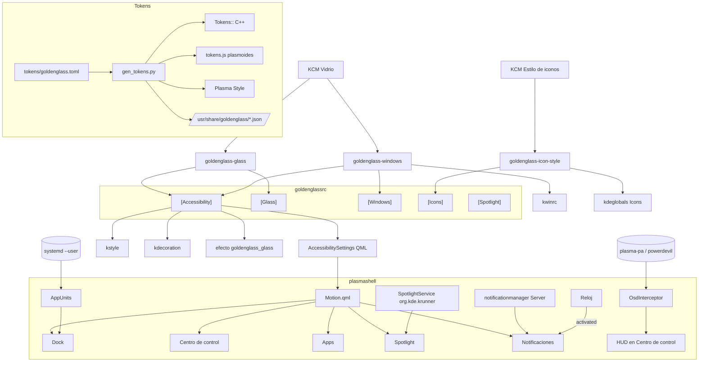
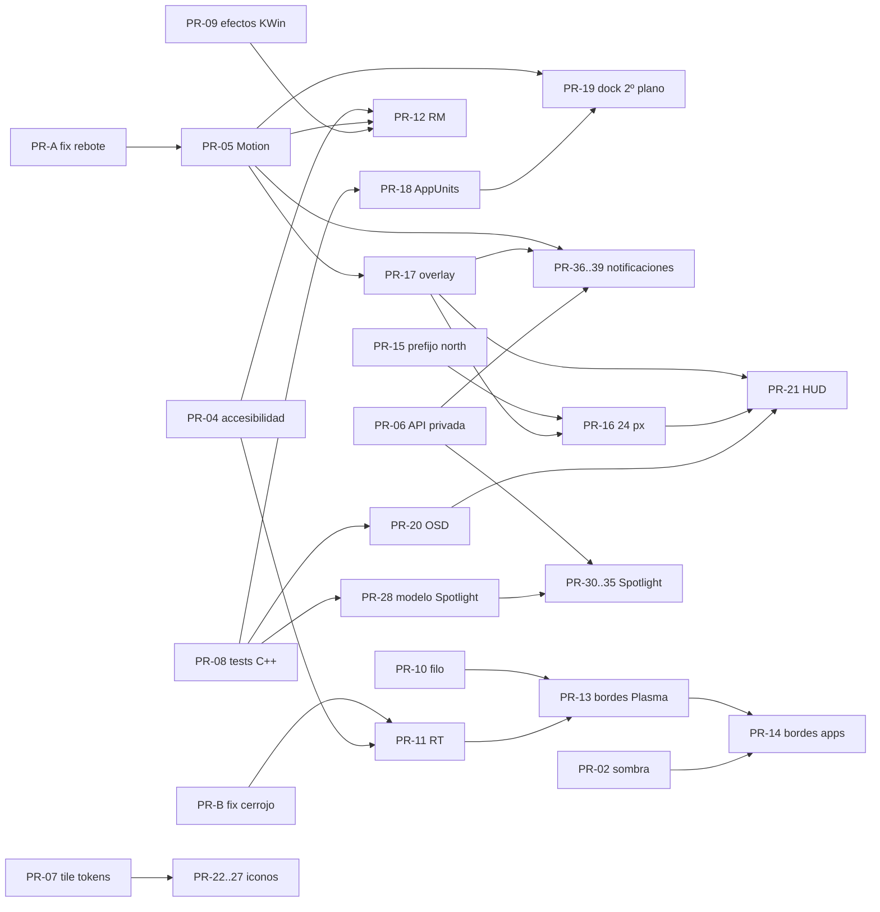

<!-- SPDX-License-Identifier: GPL-3.0-or-later -->
# GoldenGlass — Plan de arquitectura e implementación: paridad con macOS 27

Plan de las fases F12–F17. Parte del análisis de brechas frente a macOS 27
"Golden Gate" y del diseño detallado de seis áreas. Las referencias `ruta:línea`
se verificaron contra `main` en 6ded13d y pueden desplazarse. Este documento
complementa a [ARCHITECTURE.md](ARCHITECTURE.md): cuando una fase se integra, su
sección pasa a ARCHITECTURE.md y aquí queda solo el estado.

## 1. Alcance

Top 10 del análisis de brechas más dos decisiones de diseño del usuario:

| # | Mejora | Área | Fase |
|---|---|---|---|
| 1 | Efectos de KWin al estilo macOS (genio, scale, sin esquina activa) y atajos de tiling | Ventanas | F13 |
| 2 | Borde oscurecido y filo de luz más intenso en el vidrio | Material | F12 |
| 3 | Sombra distinta para la ventana activa y la inactiva | Ventanas | F12 |
| 4 | «Mostrar bordes» (accesibilidad) | Material | F12 |
| 5 | Apps en segundo plano en el Dock | Dock | F14 |
| 6 | HUD de volumen y brillo bajo la barra de menús | Barra | F14 |
| 7 | «Reducir transparencia», velocidad de animación global y «Reducir movimiento» | Material / Movimiento | F12–F13 |
| 8 | Estilos de icono Tintado y Transparente | Iconos | F15 |
| 9 | Spotlight propio con vistas, portapapeles y teclas rápidas | Spotlight | F16 |
| 10 | Centro de notificaciones y avisos de vidrio | Notificaciones | F17 |
| + | Semáforos grises en las ventanas inactivas | Ventanas | F12 |
| + | Barra de menús a 24 px, tras un spike | Barra | F14 |

### Decisiones ya tomadas por el usuario

| Tema | Decisión |
|---|---|
| Alcance | Solo el top 10, más los dos extras |
| Semáforos inactivos | Grises, como macOS; a color al pasar el ratón por el grupo |
| Barra de menús | Spike; bajar a 24 px si es estable, si no quedarse en 28 conservando el desacople |
| Spotlight | Sustituye a KRunner de fábrica, con un interruptor para volver |
| Selector de estilo de iconos | Módulo de Ajustes nuevo «Estilo de iconos» |
| Apps en segundo plano | Fijadas, y no fijadas solo si se vieron con ventana en la sesión o las lanzó el usuario (no `@autostart`) |
| Atajos de tiling | `Meta+Ctrl+F` / `C` / `R`; mitades nativas con `Meta+flechas`; cuartos encadenando |

Las decisiones que siguen abiertas están en el §9, cada una con su
recomendación. El plan asume la recomendación hasta que el usuario diga otra
cosa.

## 2. Principios para todas las fases

1. **Tokens como única fuente de verdad.** Todo valor visual nuevo va en
   `tokens/goldenglass.toml`, en su propia sección, y se valida en
   `tools/gen_tokens.py` (`REQUIRED_SECTIONS` y rangos). Los valores de macOS sin
   cifra pública se marcan «calibrar», como ya hace el archivo. De paso se
   corrigen dos incumplimientos existentes: los colores del tile de iconos
   (`tools/icons_apps.py:24-58`) y el 0.4 del contorno de la sombra
   (`kdecoration/goldenglassdecoration.cpp:1143`).
2. **Spike antes que código.** Cada riesgo de plataforma tiene un spike con una
   pregunta, un criterio go/no-go y un plan B (§5). Los spikes van en ramas
   `task/spike-*` que no se integran; el resultado se documenta en el PR que
   depende de ellos.
3. **Degradación sin roturas.** Todo uso de C++ propio o de API privada de
   Plasma en QML se carga detrás de un `Loader` en un archivo aparte (el patrón
   de `GlassBlur.qml`). Si falta el módulo, la función se apaga y el plasmoide
   sigue funcionando como hoy.
4. **No pisar al usuario.** Los valores de fábrica de sistema (kwinrc,
   kglobalshortcuts, plasmanotifyrc) solo se escriben si la clave está vacía, y
   se marcan con una versión de migración (`goldenglassrc [*] DefaultsVersion`).
5. **Herramientas de sesión con el mismo patrón.** `--check` en el autostart,
   que solo actúa si el Global Theme es `org.goldenglass.*`; `kwriteconfig6
   --notify`; recarga en vivo por D-Bus; pruebas con kread y kwrite en memoria.
   Las funciones `kread`, `kwrite` y `effects_call` se mueven a
   `tools/ggcommon.py` con el primer consumidor nuevo (PR-09) en lugar de
   copiarse en cada herramienta.
6. **Pruebas aisladas.** Los tests de `tools/` aíslan `HOME` y `XDG_*`. Las
   herramientas de vidrio escriben el tema en vivo, y no se captura nunca la
   ventana activa del usuario: las capturas son del KWin virtual de
   `tools/sandbox.sh`. Las pruebas de D-Bus van con `dbus-run-session` y hacen
   `QSKIP` si no hay bus.
7. **Reglas del repo.** Una rama corta por PR (`feature/*`, `task/*`, `fix/*`),
   commits en inglés con `git commit -s`, sin atribución de IA, cabecera SPDX en
   los archivos nuevos, y `reuse lint`, `check_i18n.sh` y `check_spdx.sh` en
   verde.

## 3. Arquitectura transversal

Hay piezas que piden varias áreas. Se diseñan una vez y se integran antes que
sus consumidores. Las conciliaciones entre equipos (R1–R8) están al final de
esta sección.

### 3.1 Contrato de accesibilidad

**Persistencia:** grupo `[Accessibility]` de `~/.config/goldenglassrc`, escrito
siempre con `KConfig::Notify`.

| Clave | Token de fábrica | Lo aplica | Lo escribe |
|---|---|---|---|
| `ShowBorders` | `accessibility.show_borders = false` | Plasma Style, shader, decoración, kstyle y GTK (fase 2) | `goldenglass-glass --borders on\|off` |
| `ReduceTransparency` | `accessibility.reduce_transparency = false` | Plasma Style, efecto de KWin, kstyle, decoración y plasmoides | `goldenglass-glass --reduce-transparency on\|off` |
| `ReduceMotion` | `accessibility.reduce_motion = false` | `Motion.qml` y efectos de KWin | `goldenglass-windows --reduce-motion on\|off` |

**Cómo llega a cada capa:**
- **C++:** `tools/cxx_tokens.py` genera `AccessibilityShowBorders`,
  `AccessibilityReduceTransparency` y `AccessibilityReduceMotion`. Hay un
  `<group name="Accessibility">` en `kstyle/goldenglass.kcfg` y en
  `kdecoration/goldenglasssettingsdata.kcfg`, con `<default code="true">`
  apuntando a los tokens.
- **QML:** **un solo** tipo, `AccessibilitySettings`, en `qmlplugin/` (módulo
  `org.goldenglass.glass`). Copia el patrón de `MenuBarSettings`: un
  `KConfigWatcher` filtrado por grupo. Propiedades con NOTIFY: `showBorders`,
  `reduceTransparency` y `reduceMotion`.
- **KCM Vidrio:** un bloque «Accesibilidad» bajo «Barra de menús», con los
  interruptores «Reducir transparencia», «Mostrar bordes» y «Reducir
  movimiento». Las dos primeras llaman a `goldenglass-glass` y la tercera a
  `goldenglass-windows`, ambas por `QProcess`. La cola de `m_process` se
  generaliza a peticiones con clave (`level`, `borders`, `rt`, `rm`): un proceso
  a la vez y la última petición por clave.
- **Propagación en vivo:** se reutiliza la de `tools/glass.py:132-162`:
  1. kwrite con `--notify`;
  2. Plasma Style del paquete o regeneración de `GoldenGlassTuned`;
  3. rebote del tema;
  4. D-Bus `org.goldenglass.Style.reparseConfiguration`;
  5. `org.kde.KWin.reconfigure`;
  6. `KConfigWatcher` en los plasmoides.
- **Refactor de `tools/glass.py`:** `set_level` pasa a ser
  `apply(tokens, *, level=None, borders=None, reduce_transparency=None,
  reload_plasma=True)`; lo que no se pasa se lee de `goldenglassrc`. El tema del
  paquete solo se usa con el nivel de fábrica y sin `borders` ni RT.

### 3.2 Movimiento: `Motion.qml`

Es un singleton QML (`pragma Singleton` + `qmldir`) en
`org.goldenglass.launchpad/contents/ui/`, que `tools/plasmoids.py:SHARED` copia a
`dock`, `controlcenter`, `spotlight` y `notifications`.

```qml
readonly property real factor: Kirigami.Units.longDuration / T.tokens.motion.kirigami_long_ms
readonly property bool animated: Kirigami.Units.longDuration > 1
readonly property bool reduced: reduceLoader.item ? reduceLoader.item.reduceMotion : false
function ms(base)      // duración × factor global (fundidos, colores)
function moveMs(base)  // 0 con reduced (escala, desplazamiento, resorte)
function fadeMs(base)  // con reduced, fundido de motion.reduced_fade_ms
function overshoot(v)  // 0 con reduced
```

- **Lectura de la clave:** `MotionReduce.qml`, en un `Loader`, instancia
  `AccessibilitySettings`; si falta el módulo C++, `reduced` vale `false`.
- **Tokens nuevos:** `[motion] kirigami_long_ms = 200` y
  `reduced_fade_ms = 150`. Todos los `*_ms` de los plasmoides se reinterpretan
  como «duración a factor 1». Las esperas de interfaz (`label_delay_ms`,
  `preview_hide_ms`, `bar_hide_ms`, `glass_update_ms`) no se escalan.
- **Guarda de CI** (`tools/tests/test_motion.py`): falla si un `duration:` de
  `plasma/plasmoids/**/*.qml` usa un token `_ms` sin pasar por `Motion.`.
- **Semántica de «Reducir movimiento»:** es una clave propia que se suma al
  factor global de KDE y no lo pisa (§4.7).

### 3.3 Módulos C++ para QML

| Módulo | Tipos | Enlaza | Paquete |
|---|---|---|---|
| `org.goldenglass.glass` (existe) | `GlassRegion`, `MenuBarSettings`, **`AccessibilitySettings`**, **`AppUnits`**, **`OsdInterceptor`/`OsdHost`**, opcional **`GlobalAction`** | Qt Quick, KWindowSystem, KConfigCore, **Qt6::DBus**, opcional KF6::GlobalAccel | `goldenglass-kstyle` |
| `org.goldenglass.spotlight` (nuevo) | `SpotlightModel`, `SpotlightService`, `ActionCatalog`, `QuickKeys` | KF6::Runner ≥ 6.9, KF6::Service, KF6::ConfigCore, Qt6::DBus | `goldenglass-kstyle` |

Spotlight va en un módulo aparte para que la dependencia de KRunner no impida
cargar `GlassRegion`. Las pruebas de los dos módulos comparten la
infraestructura `qmlplugin/tests/`: ctest offscreen,
`QStandardPaths::setTestModeEnabled`, buses de prueba con servicios falsos
(systemd1, osdService, krunner) y `check()` del PKGBUILD con
`dbus-run-session`. Esa infraestructura entra sola en el PR-08 para que los
tres PRs de C++ no choquen.

### 3.4 Superficie de API privada de Plasma

`tools/check_plasma_compat.py` hoy solo comprueba que existen los módulos
importados. Se añade `tools/plasma_api.toml`: por cada módulo privado, los
tipos, propiedades, métodos, valores de enum y roles que se usan. Se comprueba
contra los `.qmltypes` instalados. Además verifica:
- que `org.kde.krunner.App.xml` tiene sus 6 métodos;
- que `org.kde.krunner.desktop` sigue `DBusActivatable`;
- que existe `plasma-runner-baloosearch.desktop`.

Si falta algo, el error indica el archivo QML que lo usa. Cubre
`notificationmanager`, `private.clipboard`, `private.kicker`, `private.volume`
y `taskmanager`. Lo piden Spotlight y Notificaciones, y se hace una sola vez
(PR-06), antes que ellos.

### 3.5 Vidrio en QML

- **`GlassRegion` respeta `clip`:** `collect()` (`qmlplugin/glassregion.cpp:124-143`)
  recorta cada rectángulo por los ancestros con `clip: true`. Sin esto, las
  listas con desplazamiento (resultados de Spotlight, Centro de notificaciones)
  piden blur fuera de la vista.
- **`GlassOverlay.qml`:** generaliza `controlcenter/FloatingPanel.qml` sin
  cambiar su comportamiento. Añade `origin: "icon" | "edge"`, `resetContent()`,
  tokens de animación inyectados y el margen superior tomado de
  `availableScreenRect`, no del token. Lo usan el Centro de control y el Centro
  de notificaciones.
- **Geometría real de la barra:** `FloatingPanel.qml:196` y
  `controlcenter/main.qml:240` dejan de usar `plasma.menubar_height`. Lo
  necesitan el HUD y la barra a 24 px.
- **`DoNotDisturb.qml`:** la lógica de `controlcenter/main.qml:145-172` se
  extrae a un componente compartido con el plasmoide de notificaciones.

Las cuatro cosas van en un mismo PR sin cambio visible (PR-17).

### 3.6 Herramientas de sesión

| Herramienta | Nueva o existente | Autostart | Responsabilidad |
|---|---|---|---|
| `goldenglass-glass` | existe | `--check` | Nivel, refracción, bordes y RT. Gana `apply()` y el cerrojo `fcntl.flock` en `$XDG_RUNTIME_DIR/goldenglass-glass.lock` |
| `goldenglass-windows` | **nueva** (`tools/windows.py`) | `--check`, fase 1 | Efectos y bordes de kwinrc, script de atajos, `--reduce-motion` |
| `goldenglass-icon-style` | **nueva** (`tools/icon_style.py`) | `--watch` (demonio, como `gtk_sync`) | Resuelve y aplica el tema de iconos según estilo, apariencia y esquema |
| `goldenglass-notifications` | **nueva** (`tools/notifications.py`) | `--check` | Quita o devuelve el applet de notificaciones de Plasma; nunca deja los dos ni ninguno |
| `goldenglass-wrap-icons` | existe | `--if-changed` | Gana el extractor de glifos y las variantes Tintado y Transparente |

Cada una lleva su `_launcher` y su `_autostart` en el PKGBUILD y su entrada en
`tools/install.sh`.

**Datos en tiempo de ejecución.** Los tokens no se instalan. Las herramientas
que corren en el equipo del usuario leen un JSON generado e instalado en
`/usr/share/goldenglass/`, y en el repo vuelven al TOML. Lo usan `icon-style.json`
y, si hace falta, los valores de fábrica de `windows.py`.

### 3.7 Mapa de componentes



### 3.8 Conciliaciones entre equipos

| # | Conflicto | Resolución |
|---|---|---|
| R1 | Dos tipos QML para leer accesibilidad (`AccessibilitySettings` y `MotionSettings`) | Un solo `AccessibilitySettings`; `MotionSettings` no se crea |
| R2 | `--reduce-motion` reservado en `goldenglass-glass` y propuesto en `goldenglass-windows` | Va en `goldenglass-windows`, porque toca los efectos de KWin; el KCM llama a cada herramienta por su clave |
| R3 | `Motion.js` + `[animation].plasma_long_ms` (Notificaciones) frente a `Motion.qml` + `[motion].kirigami_long_ms` | Se usa `Motion.qml` y `[motion]`; desaparece el PR `task/follow-plasma-animation-speed` |
| R4 | Dos ampliaciones de `check_plasma_compat` (`REQUIRED_TYPES` y `plasma_api.toml`) | Un solo manifiesto `plasma_api.toml` (PR-06) |
| R5 | `FloatingPanel.qml:196` corregido a la vez en el HUD y en la barra de 24 px | Se corrige en PR-17, que integran antes los dos |
| R6 | Tres PRs de C++ tocan `qmlplugin/CMakeLists.txt` y crean pruebas D-Bus | Infraestructura común en PR-08; luego se integra un PR de C++ cada vez y se rebasan los demás |
| R7 | El cerrojo de `glass.py` y el bucle de rebote del dock con duración 0 son fallos latentes | Ramas `fix/*` propias en la ola 1, no escondidas dentro de features |
| R8 | El script falso `kcm/tests/bin/goldenglass-glass` hace `printf > goldenglassrc` y borraría `[Accessibility]` | Se corrige en PR-04, antes de que nadie escriba ese grupo |

## 4. Diseño por mejora

Cada apartado sigue el mismo orden: referencia de macOS, estado actual, diseño,
tokens, pruebas, riesgos y PRs. Los spikes que se citan (SP-xx) están en el §5.

### 4.1 Semáforos grises en las ventanas inactivas

- **Referencia macOS.** Con la ventana sin foco, los tres semáforos son grises
  y sin glifo. Al pasar el ratón por el grupo se colorean y muestran los glifos,
  aunque la ventana siga inactiva.
- **Estado.** El comportamiento ya está programado:
  - `kdecoration/goldenglassbutton.cpp:209` calcula
    `lit = TrafficLightInactiveColored || isActive() || m_groupHovered`;
  - el hover de grupo está en `goldenglassdecoration.cpp:~696-710`, y el de
    Finder en `kstyle/goldenglassfinder.cpp:1245`;
  - lo anula el token `traffic_lights.inactive_colored = true`
    (`tokens/goldenglass.toml:400`, commit f10452e);
  - en GTK, `tools/gtk.py:109-112` solo pone gris en `:backdrop`.
- **Diseño.**
  - El token pasa a `inactive_colored = false` y sigue siendo una constante de
    compilación.
  - GTK4/libadwaita:
    - `windowcontrols:backdrop:hover > button.close { … }`, una regla por color;
    - `windowcontrols:hover > button image { opacity: 1 }`.
  - GTK3: `:backdrop:hover` por botón. El hover de grupo queda como límite
    documentado.
  - Calibrar `traffic_light_inactive` (#D1D1D1 / #4D4D4D) e `inactive_shine`.
- **Pruebas.**
  - pytest: el CSS de GTK4 contiene las reglas de hover en backdrop.
  - `trafficlight_preview` en los estados gris, gris con ratón y pulsado.
  - Sandbox: pasar el ratón por una ventana inactiva y por un Dolphin inactivo.
    Hay que verificar que Qt entrega `HoverMove` a una ventana Wayland sin foco;
    si no, se usa el seguimiento por `Enter`/`MouseMove`, que ya existe.
- **PR-01** `feature/gray-inactive-traffic-lights`, 2 commits. Es independiente.

### 4.2 Sombra activa e inactiva

- **Referencia macOS.** macOS 27 distingue mejor la ventana activa
  («more prominent active window distinction»). La sombra inactiva es más corta
  y suave. Valores de referencia no verificados: la activa ≈ `0 22px 70px` al
  50 %; la inactiva, entre un tercio y la mitad del radio y del desplazamiento,
  con ~55 % de la opacidad.
- **Estado.**
  - Hay una sola sombra: `createShadow`, en
    `kdecoration/goldenglassdecoration.cpp:1092-1169`.
  - La clave es `ShadowKey` (`:150`), con una caché de `weak_ptr` (`:151`,
    `:1107`).
  - Nada recalcula la sombra en `activeChanged`.
  - Token actual: `[shadow.active] size = 64, strength = 0.45`.
- **Diseño.**
  - Tokens `[shadow.inactive] size = 32, strength = 0.25` (calibrar).
    `gen_tokens` rechaza una inactiva mayor que la activa.
  - En el `.kcfg`: `InactiveShadowSize` e `InactiveShadowStrength`. Los valores
    efectivos son `min(inactiva, activa)`.
  - La decoración guarda `m_activeShadow` y `m_inactiveShadow` como
    `shared_ptr`. `updateShadows()` las obtiene con `shadowFor(params)`, cuya
    clave son los parámetros resueltos (incluidos `outline_alpha` y
    `ShowBorders`).
  - `applyShadow()`, conectado a `activeChanged`, solo hace `setShadow(...)`:
    **cambiar el foco no renderiza nada**.
  - El cambio es instantáneo, porque KDecoration3 no funde sombras.
  - Token `[shadow] outline_alpha = 0.4`: saca a los tokens el valor fijo del
    código.
- **Pruebas.**
  - La resolución de parámetros es una función pura en una cabecera (como
    `glassgeometry.h`), con su test Qt.
  - Sandbox: 50 cambios de foco deben dar exactamente 2 creaciones de sombra
    (contadas con `qCDebug`).
- **Riesgo.** El `padding` de la sombra cambia con el foco: revisar que la Vista
  general y las miniaturas no salten.
- **PR-02** `feature/inactive-window-shadow`, 3 commits. Va antes de PR-14
  porque los dos tocan la clave de la sombra.

### 4.3 Borde oscurecido y filo de luz

- **Referencia macOS 27.** «More uniform refraction and improved contrast»: una
  línea oscura fina por fuera del filo de luz. Las cifras están sin verificar.
- **Estado y problema.**
  - `kwin-effect/shaders/glass.frag:91-94` dibuja el filo, y
    `kwin-effect/glass.cpp:300-311` multiplica lente, nitidez y filo por el
    mismo `opaque_factor`.
  - El shader pinta **debajo** del relleno SVG del Plasma Style
    (`drawWindow`, `glass.cpp:559-565`). El filo visible es
    (1 − α del relleno) × aporte:
    - hoy: 0,072 / 0,026 / 0,003 en los niveles claro, medio y opaco;
    - con la propuesta: 0,13 / 0,062 / 0,013.
- **Diseño mixto.**
  - **(a) Shader.**
    - Una banda exterior multiplicativa, `edgeShade`, de `edgeShadeWidth` px
      (escalada por `viewport.scale()`).
    - El filo se desplaza hacia dentro, para que su máximo quede justo después
      de esa banda.
    - El filo y la banda usan un factor propio,
      `rimFactor = 1 + (rim_opaque_factor − 1)·level`; la lente sigue con
      `opaque_factor`.
    - Con RT todo vale 0; con `ShowBorders`, `edgeShade` toma el valor de
      `borders`.
  - **(b) SVG** (`tools/plasma_theme.py`, `glass_surface` y
    `_tile_border(inset)`): un filo exterior negro con `shade_alpha` y otro
    interior blanco con `highlight_alpha`. Son colores fijos con alfa, válidos
    en claro y en oscuro. Se ven en todos los niveles, también con el Blur de
    reserva.
- **Tokens.**
  - `[glass.refraction]`: `specular = 0.22` (antes 0.12),
    `rim_opaque_factor = 0.6`, `edge_shade = 0.18`, `edge_shade_width = 1.5`.
  - `[glass.border]`: `shade_alpha = 0.16`, `highlight_alpha = 0.22`,
    `width = 1`.
- **Pruebas.**
  - pytest: el SVG lleva los dos filos.
  - `test_cxx_tokens`.
  - Sandbox en los niveles 0, 0,5 y 1, en claro y oscuro, y a escala 1,25 y 1,5.
    En un corte perpendicular al borde, el orden debe ser: línea oscura
    (≤ 2 px), pico de luz y cuerpo.
  - `showfps` antes y después: diferencia < 2 %.
- **Spike SP-01.** ¿Un segundo pase de filo, *después* de `effects->drawWindow`
  y solo sobre la banda del borde, pone el filo encima del contenido como en
  Liquid Glass?
  - Si sale go, el filo y el oscurecido pasan a ese pase y `specular` se
    recalibra hacia ~0,10.
  - Si sale no-go, se queda la compensación más el filo del SVG.
- **PR-10** `feature/glass-edge-contrast`, 4 commits. Depende de SP-01.

### 4.4 Reducir transparencia

- **Referencia macOS.** Barra, Dock, sidebars, menús y Centro de control pasan
  a opacos, sin blur ni refracción.
- **Estado.** No existe. La muesca más opaca vale `alpha = 0.90`
  (`tokens:59-61`).
- **Diseño.** Se conserva el nivel del usuario (`[Glass] Level`); RT lo
  sustituye por un nivel efectivo.
  - **`glass.py`:**
    - `alpha = accessibility.reduce_transparency_alpha` (1.0);
    - `STYLE_KEYS` = 100, así el estilo y la decoración quedan opacos sin
      cambiar su código;
    - Tuned con `translucent/` a alfa 1;
    - en el `plasmarc` del tema, `[BlurBehindEffect]` y `[ContrastEffect]` con
      `enabled=false`.
  - **Efecto de KWin:** `reconfigure` lee RT y pone a 0 la fuerza, la claridad,
    el especular y el oscurecido. No toca `kwinrc [Plugins]`.
  - **Plasmoides** (con `AccessibilitySettings`):
    - `Tile.qml:32` usa alfa 1;
    - `AppsPanel.qml:79-85` usa el nivel 1;
    - el slider del Centro de control (`main.qml:540-560`) queda deshabilitado.
  - **KCM:** con RT, el slider y la Refracción quedan deshabilitados con la nota
    «Desactivado por Reducir transparencia».
- **Token.** `[accessibility] reduce_transparency_alpha = 1.0`.
- **Pruebas.**
  - pytest: RT on da `STYLE_KEYS` = 100, Tuned sin blur y `Level` intacto; RT
    off recupera el nivel.
  - ctest `kcm_apply_test`.
  - Sandbox: sin región de blur, y `showfps` igual a «sin efecto».
- **Spike SP-03.** ¿Respeta libplasma 6.8 `[BlurBehindEffect] enabled=false`
  en Dialog, PanelView y `GlassRegion`? Si no, el efecto descarta las
  superficies él mismo cuando RT está activo.
- **PR-11** `feature/reduce-transparency`, 5 commits. Depende de PR-04 y PR-B y
  es requisito de PR-13.

### 4.5 Mostrar bordes

- **Referencia macOS 27.** Accesibilidad › Pantalla › Mostrar bordes: un borde
  oscuro fino en botones, campos y toolbar. Sustituye a «Mostrar formas de los
  botones de la toolbar». No está verificado si alcanza a las ventanas y los
  menús.
- **Diseño por capa.** Todas leen `ShowBorders`.

| Capa | Cambio | Cómo se entera |
|---|---|---|
| Plasma Style | `build(..., borders)`: filo exterior de color de texto `surface_alpha`; campos con `field_alpha` | Regeneración de Tuned |
| Shader | `edgeShade = borders.edge_shade`, `rimFactor = 1` | `KWin.reconfigure` |
| Decoración | `outlinesEnabled = OutlineEnabled \|\| ShowBorders` (hoy `OutlineEnabled=false`, `goldenglasssettingsdata.kcfg:176`); color `mix(Frame, Text, window_outline_contrast)`; contorno de la sombra con `window_shadow_outline_alpha` | `KWin.reconfigure` |
| kstyle | Filo de 1 px en `renderButtonFrame` (`goldenglasshelper.cpp:734`) y `renderLineEdit` (`:933`); forma de los botones de toolbar sin hover (`goldenglassstyle.cpp:4616-4660`); cápsulas de Finder (`goldenglassfinder.cpp:781,1174`) | D-Bus `reparseConfiguration` |
| GTK (fase 2) | Bloque CSS de usuario con la marca, vía `gtk_sync` | Al reabrir la app (SP-02) |

- **Tokens `[accessibility.borders]`.** `surface_alpha = 0.50`,
  `field_alpha = 0.45`, `edge_shade = 0.35`, `window_outline_contrast = 0.5`,
  `window_shadow_outline_alpha = 0.8`, `control_alpha = 0.35`,
  `toolbar_button_alpha = 0.22`, `gtk_alpha = 0.35`.
- **Pruebas.**
  - pytest: matriz nivel × bordes × RT (patrón de `GlassLevelTest`,
    `tools/tests/test_robustness.py:110`) y el cerrojo.
  - `kcm_apply_test` y `styleconfig_test`.
  - `preview_style.py`, y el sandbox con `systemsettings` y Dolphin.
- **PRs.**
  - **PR-13** `feature/show-borders-plasma`: tokens, Plasma Style, shader, CLI y
    KCM. Depende de PR-10 y PR-11.
  - **PR-14** `feature/show-borders-apps`: decoración y kstyle. Depende de PR-02
    y PR-13.
  - Opcional: `feature/show-borders-gtk`, tras SP-02.

### 4.6 Efectos de KWin y atajos de tiling

**Hallazgos.**
- **scale** ya es el efecto de abrir y cerrar por defecto en KWin 6.8.1:
  `fade` no está activo y los dos comparten un grupo exclusivo.
- **Genio:** Magic Lamp es *builtin* y viene desactivado. Comparte el grupo
  exclusivo `minimize` con `squash`, que está activo.
- **Iconos del dock:** el dock ya publica su geometría
  (`DockView.qml:527-547`, `requestPublishDelegateGeometry`).
- **Centrar:** existe la acción `Window Move Center`, sin tecla.
- **Mitades y cuartos:** las mitades son nativas con `Meta+flechas`; los cuartos
  existen sin tecla y se alcanzan encadenando.
- **Esquinas activas:** el enum `ElectricBorder` tiene TopLeft=7 y None=9.
- **Cómo se aplican hoy los valores de fábrica:** el layout script solo los
  aplica con `--resetLayout`, sin leer antes ni recargar KWin, así que no sirve
  para actualizar instalaciones existentes.

**Diseño: `goldenglass-windows`** (`tools/windows.py`), con una tabla
`DEFAULTS` de grupo, clave, valor y condición:

| Grupo | Clave | Valor | Condición |
|---|---|---|---|
| `Plugins` | `magiclampEnabled` / `squashEnabled` | `true` / `false` | Las dos vacías |
| `Plugins` | `scaleEnabled` / `fadeEnabled` | `true` / `false` | Las dos vacías |
| `Effect-scale` | `InScale` / `OutScale` / `Duration` | `kwin.open_scale` 0.92 / `kwin.close_scale` 0.95 / `kwin.window_anim_ms` 220 | Ausentes |
| `Effect-overview` | `BorderActivate` | `9` | Ausente o `7` |
| `Effect-windowview` | `BorderActivate`, `BorderActivateAll`, `BorderActivateClass` | `9` | Ausentes o `7` |
| `ElectricBorders` | `TopLeft` | `None` | Ausente |
| `Plugins` | `org.goldenglass.shortcutsEnabled` | `true` | Vacía |

- **`--check`:** se ejecuta en el autostart, fase 1, y solo con un Global Theme
  `org.goldenglass.*`.
- **Marcador de migración:** `goldenglassrc [Windows] DefaultsVersion=1`.
- **Recarga en vivo:** `/Effects loadEffect|unloadEffect` y
  `/KWin reconfigure`.
- **El layout script no cambia.**

**Atajos** (en `plasma/kwin/scripts/org.goldenglass.shortcuts/contents/code/main.js`):

| Acción | Tecla | Implementación |
|---|---|---|
| Llenar | `Meta+Ctrl+F` | `w.setMaximize(true, true)` |
| Centrar | `Meta+Ctrl+C` | `invoke("Window Move Center")` |
| Volver | `Meta+Ctrl+R` | `invoke("Window Restore")`; lógica propia si falla SP-06 |

Las tres teclas están libres. `Meta+Ctrl+flechas` ya cambia de escritorio. Los
títulos de los atajos van en inglés, como los que ya existen.

- **Pruebas.**
  - `test_windows.py`, con config en memoria:
    - instalación limpia;
    - claves tocadas por el usuario, que no se pisan;
    - segunda ejecución, que no hace nada;
    - tema Breeze, que no hace nada;
    - `BorderActivate` 7 → 9.
  - Sandbox, y una actualización con un `kwinrc` real y otro previo.
  - KGlobalAccel por D-Bus: cada tecla tiene un único dueño.
- **PRs.**
  - **PR-03** `feature/window-tiling-shortcuts`. Es independiente.
  - **PR-09** `feature/macos-window-effects`. Depende de SP-05 en cuanto a
    `genie_ms` y de SP-06.

### 4.7 Velocidad de animación global y Reducir movimiento

- **Estado.** Las duraciones de los plasmoides son fijas e ignoran
  `AnimationDurationFactor` (la máquina de desarrollo lo tiene en 0.25). Los
  sitios afectados:
  - `FloatingPanel.qml:120-161`;
  - `controlcenter/main.qml:306,314`;
  - `Tile.qml:55,63`;
  - `AppsPanel.qml:380-413`;
  - `GlassScrollView.qml:192-359`;
  - `DockIcon.qml:77,84`;
  - `DockView.qml:73,396,426`.

  **Fallo latente:** `DockIcon.qml:90-96` reinicia el rebote en `onFinished`;
  con duración 0 se convierte en un bucle por fotograma.
- **Diseño.**
  - `Motion.qml` (§3.2) y sustitución mecánica en todos los sitios.
  - `DockIcon.bounce()` no hace nada si `!Motion.animated || Motion.reduced`.
  - `GlassScrollView` con `reduced` usa `StopAtBounds`.
  - La ampliación del dock no cambia.
- **«Reducir movimiento».** Es una clave propia y no fija el factor global.
  Fijarlo pisaría la preferencia del usuario y apagaría todas las animaciones;
  macOS no las quita, sino que cambia el movimiento por fundidos.
  - **Plasmoides:** `moveMs` = 0 y `fadeMs` = 150 ms.
  - **KWin** (`goldenglass-windows --reduce-motion on`):
    - `scale` → `fade`;
    - `slide` → `fadedesktop`;
    - `magiclamp` → nada (token `kwin.reduce_motion_minimize = "none"`).
  - **Volver atrás:** el estado previo se guarda en `goldenglassrc [Windows]` y
    `off` lo restaura sin pisar lo que haya cambiado el usuario.
- **Pruebas.**
  - Guarda estática de `test_motion.py`.
  - Prueba QML offscreen con factor 0, 0,25, 1 y 2. Con factor 1 los valores
    son los de hoy.
  - Sandbox con `ReduceMotion=true`: los paneles abren y cierran del todo, y el
    dock no rebota.
- **Spike SP-04.** ¿`Kirigami.Units.longDuration` cambia en vivo y qué devuelve
  con factor 0? ¿Una animación de duración 0 emite `finished`?
  - Plan B del primero: leer el factor en C++, dentro de
    `AccessibilitySettings`.
  - Plan B del segundo: forzar `visible=false`.
- **PRs.**
  - **PR-A** `fix/dock-bounce-zero-duration`. Va el primero y es pequeño.
  - **PR-05** `task/motion-singleton`: refactor sin cambio a factor 1.
  - **PR-12** `feature/reduce-motion`. Depende de PR-04, PR-05 y PR-09.
- **Fuera de este plan.** Que kstyle y kdecoration sigan el factor global:
  `task/style-animation-factor`, en C++ y aparte.

### 4.8 Barra de menús a 24 px

- **Hallazgos.**
  - No hay un mínimo fijo en el C++ de PanelView 6.8.1: el único límite es
    `minPanelHeight` de nuestro `Panel.qml`. Además, el valor recortado se
    guarda en la configuración.
  - **Carrera:** antes de tener contención, el prefijo es `""` (esquinas de
    14 px). Plasma recorta a 28 y lo guarda. Lo mismo pasa al activar el fondo
    de la barra.
  - La barra y el dock comparten `panel-background.svg` con el prefijo `""`
    (`tools/plasma_theme.py:399-414`).
  - `plasma.menubar_padding` es un token muerto.
  - `menubaritem_svg` tiene márgenes fijos de 4 px.
- **Diseño.**
  - Marcos `north-` y `mask-north-` en todas las variantes del SVG, con
    `radius.menubar` y `plasma.menubar_padding_v`. La validación pasa a
    `2*radius.menubar ≤ menubar_height`, así que `radius.dock` queda libre.
  - Guarda `minPanelHeight: containment ? … : 0` en `Panel.qml:137`,
    documentada en `UPSTREAM.md`.
  - Script de actualización del shell
    `contents/updates/goldenglass_menubar_height.js.in`: los paneles `top` con
    `systemmenu` y altura exactamente 28 pasan a 24.
- **Tokens.** `[radius] menubar = 0`; `[plasma] menubar_height = 24`,
  `menubar_padding_v = 2`, `menubar_item_inset = 3`; se elimina
  `menubar_padding`; `[control_center] icon_highlight_inset = 2`.
- **Pruebas.**
  - `test_plasma_theme.py`: prefijos en las 4 variantes y validación.
  - Sandbox: `panels()` da `top:24` tras dos reinicios y con el fondo encendido
    y apagado, con 2 salidas.
  - Escalas 1 a 2, y el tamaño de los iconos de la bandeja.
- **Spike SP-07.** ¿Se mantiene en 24 en toda la matriz? ¿Se ejecuta `updates/`
  en un shell con `X-Plasma-FallbackPackage`? ¿Caben los iconos de la bandeja?
  - Si sale no-go, la barra queda en 26 o 28 **conservando el desacople**, que
    corrige por sí mismo el recorte persistente.
- **PRs.**
  - **PR-15** `task/menubar-panel-prefix`, sin cambio visual. Depende de SP-07.
  - **PR-16** `feature/menubar-24px`. Depende de PR-15 y PR-17.

### 4.9 Apps en segundo plano en el Dock

- **Referencia.** Punto gris claro, tooltip «Ejecutándose en segundo plano» y
  la opción de menú «Detener ejecución en segundo plano». No está verificado: el
  usuario lo describe y hasta Tahoe el punto era el mismo.
- **Hallazgos.**
  - libtaskmanager no expone procesos sin ventanas, y el módulo QML de D-Bus no
    puede suscribirse a señales, así que hace falta C++.
  - Las apps que lanza KDE viven en units transitorias con el id del `.desktop`.
  - Ejemplos reales de esta máquina:
    - `app-brave\x2dbrowser@<uuid>.service`;
    - `app-<id>@autostart.service`;
    - `dbus-:1.2-org.kde.kdeconnect@0.service`;
    - `app-org.chromium.Chromium-<MainPID>.scope`.
- **Diseño. `AppUnits` en `org.goldenglass.glass`:**
  - **Conexión:** una conexión D-Bus **privada** (`goldenglass-units`) para que
    su `Subscribe()` no afecte a plasmashell.
  - **Listado:** `ListUnitsByPatterns` de `app-*.service`, `app-*.scope` y
    `dbus-*.service`. Se repite con un retardo de 250 ms tras `UnitNew`,
    `UnitRemoved` y `JobRemoved`, sin polling.
  - **Nombres:** `parseUnitName()` es una función pura, según la especificación
    de systemd.io/DESKTOP_ENVIRONMENTS. Gestiona `\x2d` y el launcher
    `flatpak`; si no resuelve el nombre, lee `SourcePath` y aplica una
    heurística de `MainPID` para Chromium.
  - **Filtro:** un `.desktop` con `Type=Application`, sin `NoDisplay` ni
    `Hidden`, sin `TerminalEmulator` y fuera de la lista de ignorados.
  - **API:** `apps`, `available`, `units(key)`, `stop(key)` (`StopUnit`, que
    manda SIGTERM al cgroup) e `isAgent(key)` (`@autostart`).
- **Regla en `DockView`.**
  - Un `TasksModel` extra sin filtros sirve para saber si la app tiene alguna
    ventana en cualquier sitio.
  - Una app está en segundo plano si su unit sigue viva, no tiene ventanas en
    ningún sitio, no está arrancando, y todo ello se mantiene durante
    `background_delay_ms`.
  - **Fijadas:** el delegado actual con `background: true`.
  - **No fijadas** (decisión del usuario): un `Repeater` tras las tareas, solo
    para apps vistas con ventana en la sesión o lanzadas por el usuario (no
    `@autostart`).
  - **Clic:** relanza la app (`requestNewInstance` o
    `SimpleFavoritesModel.trigger`).
  - **Menú:** «Detener ejecución en segundo plano» sustituye a «Salir».
  - **Sin el módulo C++:** se carga con un `Loader` (`AppUnitsSource.qml`); sin
    systemd1 la función se apaga.
- **Tokens.** `[dock] show_background = true`,
  `background_dot_alpha = 0.35`, `background_delay_ms = 1500`. En
  `main.xml.in`: `showBackground` y `backgroundIgnore`.
- **Pruebas.**
  - QTest de `parseUnitName` con los nombres reales.
  - `AppUnits` contra un systemd1 falso en un bus de prueba.
  - Sandbox: el camino sin systemd no da errores.
- **Spike SP-08.** ¿Qué unit crea cada lanzador (dock, Apps, KRunner, Kickoff,
  Dolphin, autostart, `DBusActivatable`, Flatpak, terminal)? ¿Conservan su unit
  las apps de bandeja?
  - Go: mapeo correcto en ≥ 90 % de los casos y `StopUnit` cierra limpio.
  - No-go: solo apps fijadas, o detección por StatusNotifierItem.
- **Límite aceptado.** Las apps lanzadas desde una terminal viven en el scope de
  la terminal y no se detectan. SNI queda como fase 2 opcional.
- **PRs.**
  - **PR-18** `feature/background-apps-model`. Depende de SP-08 y PR-08.
  - **PR-19** `feature/dock-background-apps`.

### 4.10 HUD de volumen y brillo

- **Referencia.**
  - Tahoe (verificado): los controles «se expanden dentro de la barra de
    menús»; es una pieza pequeña arriba a la derecha.
  - Sin verificar: que salga bajo el icono y la barra segmentada de la 27.2.
- **Hallazgos.**
  - En 6.8.1 el OSD sale del módulo QML `org.kde.plasma.workspace.osd`. Un
    `osd/Osd.qml` en el shell no tendría ningún efecto.
  - `[OSD] Enabled=false` también corta las señales `osdProgress` y `osdText`,
    y con ellas rompe el OSD de la pantalla de bloqueo.
  - La interfaz `org.kde.osdService` está en `/org/kde/osdService`, dentro de
    plasmashell.
- **Diseño (plan A).**
  - **`OsdInterceptor`** (C++, singleton dentro de plasmashell):
    1. Toma `objectRegisteredAt` y comprueba que las firmas coinciden
       exactamente.
    2. Desregistra el objeto y registra el suyo con las mismas firmas.
    3. Gestiona volumen, micrófono, reproductor, brillo, brillo por pantalla y
       teclado, y emite `osdProgress` para la pantalla de bloqueo.
    4. Reenvía el resto (OSD de texto, `hide`) al objeto original.
    5. Restaura el original al destruirse el último host.
  - **Si cambian las firmas, no hace nada** y queda el OSD de Plasma.
  - **`OsdHost`:** uno por Centro de control. Para el brillo por pantalla se
    elige el host de `screenRect`; si no, el de la pantalla con la ventana
    activa. No muestra nada si el Centro de control está abierto.
  - **`Hud.qml`** (en un `Loader`):
    - `Dialog` `OnScreenDisplay`, `NoBackground`, sin foco y transparente a la
      entrada;
    - píldora `goldenGlassTile` + `GlassRegion`, con icono y barra segmentada,
      sin porcentaje;
    - `y` = borde real de la barra + `margin_top`;
    - resorte breve y `timeout_ms`.
- **Tokens `[osd]`.** `width = 200`, `height = 36`, `margin_top = 6`,
  `screen_margin = 8`, `icon = 18`, `segments = 16`, `segment_gap = 2`,
  `bar_height = 6`, `track_alpha = 0.20`, `fill_alpha = 0.90`, `alpha = 0.30`,
  `timeout_ms = 1500`, `open_ms = 260`, `close_ms = 220`, `open_scale = 0.9`,
  `open_overshoot = 1.2`.
- **Pruebas.**
  - QTest con un Osd falso: la guarda, `volumeChanged` → `progressRequested` +
    `osdProgress`, el reenvío de `kbdLayoutChanged`, la restauración y la
    elección de host.
  - Hook del sandbox con `qdbus6 … volumeChanged`.
- **Spike SP-09.**
  1. ¿Funcionan el registro y la restauración, con la introspección idéntica?
  2. ¿Qué método llaman plasma-pa y powerdevil?
  3. ¿Sigue funcionando el OSD de la pantalla de bloqueo?
  4. ¿Respeta KWin el `x`/`y` de un `OnScreenDisplay` a escalas 1–2 y con dos
     pantallas?

  Si falla el 4, se usa `type: Notification` o un ancla `visualParent`. Si falla
  el 1, plan B: `[OSD] Enabled=false`, alimentando el HUD con las fuentes de
  PulseAudio y de brillo; se pierden los OSD de texto.
- **PRs.**
  - **PR-20** `feature/osd-interceptor`. Depende de SP-09 y PR-08.
  - **PR-21** `feature/menubar-hud`. Depende de PR-16, PR-17 y PR-20.

### 4.11 Estilos de icono Tintado y Transparente

- **Referencia.** Apariencia › «Icon & widget style»: Por defecto, Oscuro,
  Transparente y Tintado, con Claro, Oscuro y Auto. macOS 27 añade capas de
  Liquid Glass al arte de los iconos. Sin verificar: los colores exactos de
  cada combinación.
- **Comprobado con Qt 6.12.**
  - Funciona `fill="currentColor"` + `class="ColorScheme-Accent"`, y también una
    `<mask>` de luminancia de un PNG gris con relleno `currentColor`. Así un
    glifo monocromo puede seguir el acento en vivo.
  - **No** funciona `currentColor` en `feFlood` ni en `stop-color`.
- **Diseño.**
  - **Temas.** Seis, con la convención `-Dark`:
    - `GoldenGlass` y `GoldenGlass-Dark`, que ya existen;
    - `-Clear`, `-Clear-Dark`, `-Tinted` y `-Tinted-Dark`, que heredan del padre
      y solo llevan `apps/scalable`, `inherited` (enlace al del padre) y
      `wrapped`.
    - Refactor de `tools/icons.py` a `ThemeSpec`, sin ramas por nombre de tema.
  - **Apps propias.** `tools/icons_style.py` con `Style` (DEFAULT, CLEAR,
    TINTED), y `tile()` y `App.svg()` reciben el estilo:
    - Tintado oscuro: fondo grafito y glifo en `ColorScheme-Accent`.
    - Tintado claro: fondo en acento aclarado y glifo en acento oscurecido.
    - Transparente: relleno blanco o negro translúcido, filo y especular
      marcados, y glifo blanco al 92 %.
  - **Apps de terceros.** `tools/icons_glyph.py`, en Python puro y sin numpy:
    1. Renderiza a 128 px.
    2. Calcula un modelo de fondo por fila.
    3. Mide el contraste por canal.
    4. Construye la máscara: `alpha·(floor+(1−floor)·smoothstep)` con gamma.
    5. Comprueba la legibilidad (`ink` y `detail`).
    6. Si no se lee, recurre por orden a la silueta, al monograma (inicial de
       `Name=`) o a no generar el icono.
    7. Aplica las excepciones de `[icon_style.overrides]`.
  - **Datos en tiempo de ejecución:** `/usr/share/goldenglass/icon-style.json`.
  - **Selector** (decisión del usuario): KCM nuevo `kcm/iconstyle`, «Estilo de
    iconos», de peso 52, con Estilo y Apariencia. Se guarda en
    `goldenglassrc [Icons] Style=` y `Appearance=`.
  - **Aplicación:** `goldenglass-icon-style`.
    - `--apply` resuelve el tema con `resolve(style, appearance, dark)` y llama
      a `plasma-changeicons`.
    - `--watch` es un demonio que corrige el tema solo si es de la familia
      GoldenGlass. Así sobrevive a aplicar un Global Theme, que hoy escribe
      siempre el tema base (`lookandfeel.py:111`).
  - **Acento:** el del sistema, sin selector de tinte propio.
- **Tokens.**
  - `[icon_tile]`: refactor de los literales actuales, con salida idéntica byte
    a byte.
  - `[icon_style.tinted]`, `[icon_style.clear]`, `[icon_style.extract]` y
    `[icon_style.overrides]`.
- **Pruebas.**
  - Tabla de `resolve` con las 18 combinaciones.
  - Demonio con sustitutos de `kreadconfig`, `kwriteconfig` y
    `plasma-changeicons`.
  - Extractor con `QImage` sintéticos.
  - Resolución de temas con `QIcon.fromTheme` aislado.
  - Color del píxel de un icono Tintado.
  - Hoja de contacto offscreen.
  - Tamaño del paquete: ~+0,4 MB.
- **Spike SP-10.**
  - **a.** ¿El acento se actualiza en vivo en Dolphin, Apps y Dock
    (`Kirigami.Icon`) en menos de 2 s? Plan B: el demonio regenera con color
    fijo.
  - **b.** Corpus de legibilidad: ≥ 85 % sin recursos, ≤ 10 % con monograma y
    ≤ 5 % omitidos.
  - **c.** Contraste del Transparente ≥ 3:1 en el 90 % de los casos.
  - **d.** Herencia de los temas solo-apps, y `Hidden=true`.
  - **e.** El demonio no entra en bucle con el Global Theme.
- **PRs.**
  - **PR-07** `task/icon-tile-tokens`.
  - **PR-22** `task/icon-theme-spec`.
  - **PR-23** `feature/icon-glass-layers` (opcional, antes de PR-24).
  - **PR-24** `feature/icon-style-first-party`.
  - **PR-25** `feature/icon-style-glyph-extraction`.
  - **PR-26** `feature/icon-style-switcher`.
  - **PR-27** `feature/icon-style-kcm`.

### 4.12 Spotlight

- **Referencia.** Tahoe y 27, verificado:
  - `⌘Espacio`, y vistas Apps, Archivos, Acciones y Portapapeles con `⌘1–4`;
  - botones de vista al pasar el ratón o pulsar Tab;
  - Acciones agrupadas por app, con parámetros en línea;
  - teclas rápidas de 2–3 letras;
  - portapapeles con hora y tipo, retención configurable;
  - autocompletado en gris, `↑` para la búsqueda anterior, Esc por niveles.
  - macOS 27 añade una ventana arrastrable, calculadora y diccionario en el
    campo, y Siri AI, que queda fuera.
- **Hallazgos.**
  - Hoy Spotlight es KRunner + Milou (`ARCHITECTURE.md:361-362`).
  - `KRunner::ResultsModel` y `RunnerManager` son API pública de KF6 (6.31 en
    esta máquina); Milou es QML interno.
  - El contrato D-Bus `org.kde.krunner` está en
    `/usr/share/dbus-1/interfaces/org.kde.krunner.App.xml`.
  - Klipper vive dentro de plasmashell.
  - El efecto ya aplica vidrio a las ventanas de `plasmashell`.
- **Arquitectura A** (recomendada, condicionada a SP-11a/b): un plasmoide
  `org.goldenglass.spotlight` dentro de plasmashell más el módulo
  `org.goldenglass.spotlight` (§3.3).
  - **`SpotlightModel`:** un proxy sobre `ResultsModel`, con `RunnerManager`
    propio y estado en `$XDG_STATE_HOME/goldenglass/spotlightstaterc`. Cada
    vista se traduce a runners:
    - Apps → `krunner_services`;
    - Archivos → `baloosearch`;
    - Acciones → una lista de runners de sistema.
  - **`SpotlightService`** (decisión del usuario: sustituye a KRunner):
    - registra `/App` con un adaptador generado del XML instalado, y
      `/org/kde/krunner` con `Application` y `CommandLine`;
    - pide `org.kde.krunner` con `QueueService | AllowReplacement`; si hay un
      `krunner` vivo, le envía `quit`;
    - así Alt+Espacio, Alt+F2, el binario `krunner`, escribir en el escritorio,
      Kicker y el puente de Apps funcionan sin tocarlos;
    - si se suelta el nombre (interruptor apagado o plasmashell caído), KRunner
      vuelve por activación D-Bus;
    - interfaz propia `org.goldenglass.Spotlight.show(view, query)`.
  - **UI:**
    - `Dialog` sin fondo de tamaño fijo, con píldora, 4 burbujas y una tarjeta
      de resultados con `GlassScrollView`;
    - `ListView` agrupado por categoría y «Mejor resultado»;
    - pantalla activa por `KWin.activeOutputName`;
    - `Meta+Espacio` como atajo del plasmoide;
    - `Ctrl+1–4` para las vistas.
  - **Portapapeles:** `HistoryModel` privado de Klipper en un `Loader`, con
    D-Bus `org.kde.klipper` (solo texto) como reserva. «Pegar» lo convierte en el
    portapapeles actual y avisa, porque Wayland no permite inyectar `Ctrl+V`.
  - **Teclas rápidas:** en `goldenglassrc [Spotlight][QuickKeys]`, fijadas o
    plantilla.
  - **Salida de emergencia:** el modelo y el servicio no dependen de
    `Plasmoid`. Si falla SP-11a/b, se alojan en un binario con LayerShellQt
    (arquitectura B).
- **Tokens.** Unos 40 en `[spotlight]`: `width = 680`, `bar_height = 52`,
  `bar_radius = 26`, `top_fraction = 0.24`, `results_max_height = 460`,
  `row_height = 34`, `category_limit = 5`, las animaciones,
  `replace_krunner = true` y `clipboard = true`. Todos «calibrar». No hay
  colores nuevos.
- **Pruebas.**
  - ctest de `SpotlightModel` (runner falso), de `QuickKeys` y de
    `SpotlightService` (bus privado, dueño falso, la cola y todos los métodos).
  - Sandbox: capturas de las 4 vistas.
  - Manual: todos los caminos de llamada, IME, dos pantallas, matar plasmashell
    y comprobar que vuelve KRunner.
- **Spike SP-11.**
  - **a.** ¿plasmashell puede quedarse con `org.kde.krunner` y recibir los 6
    caminos de llamada?
  - **b.** ¿El `Dialog` recibe el foco 10 de 10 veces, por atajo y por D-Bus,
    en la pantalla correcta?
  - **c.** ¿Una segunda instancia de `HistoryModel` comparte el Klipper de la
    bandeja?
  - **d.** ¿Son estables los ids de `QueryMatch`?
  - **e.** ¿El catálogo de acciones llega a ≥ 50 entradas?
  - **f.** ¿Las categorías de baloosearch sirven como filtros?
- **PRs.**

  | PR | Rama | Depende de |
  |---|---|---|
  | PR-28 | `feature/spotlight-results-model` | PR-08 |
  | PR-29 | `task/extract-apps-view` | — (en paralelo) |
  | PR-30 | `feature/spotlight-plasmoid` (MVP) | SP-11a/b |
  | PR-31 | `feature/spotlight-replace-krunner` | — |
  | PR-32 | `feature/spotlight-views` | SP-11e/f |
  | PR-33 | `feature/spotlight-clipboard` | SP-11c |
  | PR-34 | `feature/spotlight-quick-keys` | SP-11d |
  | PR-35 | `feature/spotlight-settings-module` | — |

  Opcional: `feature/spotlight-preview`, la vista previa tipo Quick Look.

### 4.13 Centro de notificaciones

- **Referencia.**
  - Verificado en las guías de Apple para macOS 27:
    - se abre con un clic en la fecha y hora;
    - las acciones aparecen al pasar el ratón;
    - las notificaciones de cada app forman una pila, con «Mostrar menos» y
      «Borrar todo» por pila;
    - los widgets van debajo;
    - Enfoque se gestiona en el Centro de control.
  - Sin verificar: las medidas del aviso (unos 344 pt, radio de 20–22), la ✕ de
    vidrio y las hojas asomando por debajo de la pila.
- **Hallazgos.**
  - El applet de Plasma va **compilado**, con su QML embebido, así que no se
    pueden sustituir sus delegados.
  - El servidor `org.freedesktop.Notifications` lo registra
    `NotificationsModel` (`Server::init()`) y no el applet: lo hace cualquier
    `NotificationManager.Notifications` cargado en plasmashell.
  - Hoy el applet de Plasma está dentro de la bandeja.
- **Arquitectura.** Un plasmoide propio, solo en QML,
  `org.goldenglass.notifications`, sobre la API QML de
  `org.kde.notificationmanager`.
  - **De upstream** se copia solo lo pequeño: inhibición, configuración del
    modelo de avisos y `PulseAudio.qml`, con cabecera GPL-2.0-or-later y entrada
    en `UPSTREAM.md`.
  - **Sin duplicados:** el applet de Plasma se **descarga** de la bandeja
    (`knownItems` con él y `extraItems` sin él).
    `goldenglass-notifications --takeover|--restore|--check` cubre a los
    usuarios existentes. `--check` en el autostart garantiza que nunca estén los
    dos ni ninguno.
  - **Reloj:** busca a su hermano en la contención y emite `activated()`; si no
    lo encuentra, conserva el calendario.
  - **Pantallas:** los avisos salen en la instancia de la pantalla 0 y el Centro
    en la del reloj pulsado.
- **Componentes** (`contents/ui/`):
  - `main.qml` (indicador de luna o de progreso);
  - `Inhibition.qml`;
  - `BannerModel.qml` y `BannerManager.qml`;
  - `BannerWindow.qml` (`Dialog` de tipo Notification, sin fondo, sin foco,
    `GlassBlur`, temporizador de Plasma, pausa al pasar el ratón, arrastrar
    para descartar);
  - `NotificationCard.qml`, `JobCard.qml` y `GroupStack.qml`;
  - `CenterPanel.qml` (`GlassOverlay` con `origin: "edge"`);
  - `HistoryModel.qml`;
  - `widgets/` (fase 3).
- **Comportamiento.**
  - Se respetan `PopupTimeout`, `PopupPosition` (`CloseToWidget` = arriba a la
    derecha), `Jobs/*` y `WhenFullscreen`, `WhenScreensMirrored` y
    `WhenScreenSharing`.
  - Las alertas persistentes son las críticas, las de timeout 0 y las
    residentes.
  - Trabajos: aviso con progreso, sección «En curso» en el Centro y aviso al
    terminar.
  - No molestar se queda en el Centro de control.
  - Los atajos que se pierden al descargar el applet de Plasma (No molestar,
    borrar historial) se recuperan con `GlobalAction` (opcional).
- **Tokens `[notifications]`.** Unos 37: `banner_width = 344`,
  `banner_radius = 22`, `banner_alpha = 0.30`, `max_banners = 4`, la pila, las
  animaciones, `center_width = 344`, `max_height_fraction = 0.8`…
- **Accesibilidad.**
  - `Accessible.Notification` y `announce()`, salvo en No molestar.
  - Un aviso nunca roba el foco, salvo para responder.
  - El Centro se maneja con el teclado.
- **Pruebas.**
  - pytest: `notifications.py` es idempotente, y `check_plasma_compat` funciona
    con `.qmltypes` falsos.
  - Sandbox:
    - el propietario del servicio es plasmashell;
    - `Notify` en todas sus variantes;
    - un trabajo falso;
    - contar las ventanas de notificación con un script de KWin, para comprobar
      que no hay duplicados;
    - No molestar.
- **Spike SP-12.**
  - **a.** ¿Se descarga el applet de Plasma y queda un solo aviso por `Notify`?
  - **b.** ¿Un singleton QML se comparte entre instancias?
  - **c.** ¿El `Dialog` de tipo Notification se coloca bien y no roba el foco?
    ¿Responder obtiene el foco?
  - **d.** ¿Se puede animar `y` a 60 fps?
  - **e.** ¿El reloj puede activar a su hermano con `activated()`?

  Plan B de c: un tipo C++ sobre `PlasmaQuick::PlasmaWindow`.
- **PRs.**

  | PR | Rama | Depende de |
  |---|---|---|
  | PR-36 | `feature/glass-notification-banners` (MVP, todavía fuera del layout) | PR-05, PR-06, PR-17, SP-12 |
  | PR-37 | `feature/notifications-takeover` | Se integra **justo después** de PR-36 |
  | PR-38 | `feature/notification-center` | — |
  | PR-39 | `feature/notification-center-widgets` | — |

  Opcionales: `feature/notification-shortcuts` y `feature/dock-badges-progress`.

## 5. Spikes

Se hacen en ramas `task/spike-<id>` que no se integran, justo antes de la ola
que los necesita. El resultado (go o no-go, medidas y decisión) se copia en la
descripción del PR que depende de ellos y en ARCHITECTURE.md al integrar.

| ID | Pregunta | Go | No-go → plan B | Antes de |
|---|---|---|---|---|
| SP-01 | Pase de filo de luz encima del contenido | < 0,3 ms/fotograma a 4K en iGPU, sin artefactos ni texto tapado | Filo compensado + filo del SVG | PR-10 |
| SP-02 | GTK relee `gtk.css` en vivo; contraste por el portal | Hay portal o se relee en vivo | CSS de usuario que se aplica al reabrir la app | GTK de bordes |
| SP-03 | libplasma respeta `BlurBehindEffect enabled=false` | No se pide blur | El efecto descarta las superficies con RT | PR-11 |
| SP-04 | `longDuration` en vivo, factor 0; `finished` con duración 0 | Proporcional y emite | `factor` desde C++; `visible=false` | PR-05 |
| SP-05 | El genio llega al icono con el dock autoocultado o ampliado; `scale` sin parpadeo con `goldenglass_glass` | Acaba en el icono y sin artefactos | Republicar la geometría al mostrarse el dock; ajustar `open_scale` | PR-09 |
| SP-06 | Atajos nuevos sin pisar los del usuario; el autostart llega a tiempo; `Window Restore` con mosaico | Todo sí | Reasignar con kglobalaccel; respaldo en el layout; lógica propia | PR-03, PR-09 |
| SP-07 | Barra estable a 24 px; `updates/` se ejecuta; iconos de la bandeja | Estable en toda la matriz | 26 o 28 conservando el desacople; migrar con `goldenglass-system` | PR-15 |
| SP-08 | Units por lanzador; apps de bandeja; `StopUnit` | ≥ 90 % de mapeo y cierre limpio | Solo fijadas o StatusNotifierItem | PR-18 |
| SP-09 | Interceptar `osdService`; OSD de la pantalla de bloqueo; posición del OSD | Los 4 puntos | `type: Notification`; `[OSD] Enabled=false` | PR-20 |
| SP-10a–e | Acento en vivo, legibilidad, contraste del Transparente, herencia de temas, demonio | Ver §4.11 | Ver §4.11 | PR-24…26 |
| SP-11a–f | Nombre de KRunner, foco, Klipper, ids, catálogo, categorías | Ver §4.12 | Arquitectura B; solo texto; elegir por título… | PR-30…34 |
| SP-12a–e | Toma del servicio, singleton, ventana del aviso, recolocación, reloj → hermano | Ver §4.13 | Reiniciar plasmashell; regla de la pantalla 0; tipo C++… | PR-36…38 |

## 6. Plan de integración

### 6.1 Olas

Las olas ordenan de menor a mayor riesgo, como las fases F0–F11. Dentro de una
ola, los PRs sin dependencias entre sí pueden ir en paralelo. Las olas 4, 5 y 6
se solapan si hay capacidad, porque casi no comparten archivos.

**Ola 1 — Fallos, cimientos y victorias rápidas** (sin spikes)

| PR | Rama | Contenido | Depende de |
|---|---|---|---|
| PR-A | `fix/dock-bounce-zero-duration` | Guarda del rebote con duración 0 | — |
| PR-B | `fix/glass-tool-concurrency` | Cerrojo `flock` en `goldenglass-glass` | — |
| PR-01 | `feature/gray-inactive-traffic-lights` | §4.1 | — |
| PR-02 | `feature/inactive-window-shadow` | §4.2 | — |
| PR-03 | `feature/window-tiling-shortcuts` | Atajos de §4.6 | SP-06 (parte de atajos) |
| PR-04 | `task/accessibility-config-contract` | §3.1: tokens, kcfg, `AccessibilitySettings`, script falso del KCM (R8) | — |
| PR-05 | `task/motion-singleton` | §3.2 sin cambio de comportamiento a factor 1, con la guarda de CI | SP-04, PR-A |
| PR-06 | `task/plasma-api-manifest` | §3.4 | — |
| PR-07 | `task/icon-tile-tokens` | Tokens del tile; salida idéntica byte a byte | — |
| PR-08 | `task/qmlplugin-test-infra` | `qmlplugin/tests/`, `dbus-run-session` en `check()` y en CI | — |

**Ola 2 — Material y ventanas (F12, F13)**

| PR | Rama | Depende de |
|---|---|---|
| PR-09 | `feature/macos-window-effects` (`goldenglass-windows`) | SP-05, SP-06 |
| PR-10 | `feature/glass-edge-contrast` | SP-01 |
| PR-11 | `feature/reduce-transparency` (`glass.py apply()`, bloque «Accesibilidad» del KCM) | PR-04, PR-B, SP-03 |
| PR-12 | `feature/reduce-motion` | PR-04, PR-05, PR-09 |
| PR-13 | `feature/show-borders-plasma` | PR-10, PR-11 |
| PR-14 | `feature/show-borders-apps` | PR-02, PR-13 |

**Ola 3 — Barra de menús y Dock (F14)**

| PR | Rama | Depende de |
|---|---|---|
| PR-17 | `task/share-glass-overlay` (§3.5) | PR-05 |
| PR-15 | `task/menubar-panel-prefix` | SP-07 |
| PR-16 | `feature/menubar-24px` | PR-15, PR-17 |
| PR-18 | `feature/background-apps-model` | SP-08, PR-08 |
| PR-19 | `feature/dock-background-apps` | PR-18, PR-05 |
| PR-20 | `feature/osd-interceptor` | SP-09, PR-08 (se rebasa sobre PR-18) |
| PR-21 | `feature/menubar-hud` | PR-16, PR-17, PR-20 |

**Ola 4 — Iconos (F15):** PR-22 → (PR-23) → PR-24 → PR-25 → PR-26 → PR-27.
Depende de PR-07 y SP-10.

**Ola 5 — Spotlight (F16):** PR-28 ∥ PR-29 → PR-30 → PR-31 → PR-32 → PR-33 ∥
PR-34 → PR-35. Depende de PR-06, PR-08, PR-05 y SP-11.

**Ola 6 — Notificaciones (F17):** PR-36 → PR-37 (inmediato) → PR-38 → PR-39.
Depende de PR-05, PR-06, PR-17 y SP-12.



### 6.2 Archivos compartidos y reglas de conflicto

| Archivo | Lo tocan | Regla |
|---|---|---|
| `tokens/goldenglass.toml` | Casi todos | Cada PR añade **su propia sección** (o claves dentro de la suya). Las secciones nuevas van al final, en orden de integración; se rebasa antes de integrar y `gen_tokens.py` valida |
| `tools/gen_tokens.py` (`REQUIRED_SECTIONS`) y `tools/cxx_tokens.py` | PR-02, 04, 10, 11, 13, 18, 20, 28, 36… | Una línea por sección; conflictos triviales |
| `kcm/ui/main.qml`, `kcm/glasskcm.*`, `kcm/tests/*` | PR-04, 11, 12, 13 | PR-11 crea el bloque «Accesibilidad» y la cola por clave; PR-12 y PR-13 solo añaden su interruptor |
| `tools/glass.py` | PR-B, 11, 13 | PR-B (cerrojo) → PR-11 (`apply()`) → PR-13 (`borders`) |
| `tools/plasma_theme.py` | PR-10, 11, 13, 15 | PR-15 (prefijo `north-`) puede ir antes o después; el resto en orden de ola |
| `qmlplugin/CMakeLists.txt` | PR-04, 08, 17, 18, 20, opcional `GlobalAction` | Un PR de C++ a la vez; el siguiente rebasa |
| `tools/plasmoids.py` (`SHARED`) | PR-05, 17, 19, 30, 36 | Una entrada por plasmoide destino |
| `org.kde.plasma.desktop-layout.js` | PR-30, 36/37 | Spotlight y notificaciones en `addWidget` separados; la bandeja (`knownItems`) solo en PR-37 |
| `controlcenter/main.qml`, `FloatingPanel.qml` | PR-05, 11, 16, 17, 21 | PR-17 extrae primero; los demás trabajan sobre `GlassOverlay` |
| `plasma/shell/.../Panel.qml` | PR-15 | Solo la guarda; documentada en `UPSTREAM.md` |
| `packaging/goldenglass/PKGBUILD`, `tools/install.sh` | PR-08, 09, 24–26, 28, 37 | Un `_launcher` y un `_autostart` por herramienta; dependencias nuevas: `krunner` y `kservice` en `goldenglass-kstyle` |
| `docs/ARCHITECTURE.md`, `CHANGELOG.md` | Todos | Cada PR documenta su sección; las fases F12–F17 se marcan ✅ al cerrar su ola |

### 6.3 Criterio de terminado (por PR)

- CI en verde: ruff, qmllint, ctest, pytest, `check_plasma_compat`,
  `check_i18n.sh`, `reuse lint` y `check_spdx.sh`.
- Tokens nuevos validados y sin valores visuales sueltos en el código.
- Pruebas del PR aisladas (HOME y XDG, buses privados, sandbox).
- Sesión real revisada con la lista manual del apartado, sin capturar la
  ventana activa.
- La función se degrada sin errores si faltan el módulo C++, systemd1 o la API
  privada.
- `docs/ARCHITECTURE.md`, `CHANGELOG.md`, `UPSTREAM.md` (si hay copias de
  upstream) y `po/es` al día.

## 7. Estrategia de pruebas

| Nivel | Herramienta | Qué cubre |
|---|---|---|
| Unidad Python | pytest (`tools/tests/`) | Generadores, tokens, herramientas de sesión con config en memoria, extractor de glifos, compatibilidad con fixtures, guarda de `Motion` |
| Unidad C++ | ctest offscreen | Geometría de sombras, `parseUnitName`, `AppUnits`, `OsdInterceptor`, `SpotlightModel`, `QuickKeys`, `SpotlightService`, `AccessibilitySettings` |
| Integración D-Bus | `dbus-run-session` + servicios falsos | systemd1, osdService, krunner y klipper |
| QML | qmllint + pruebas offscreen opcionales | Duraciones, carga con y sin módulos C++ |
| Sistema | `tools/sandbox.sh` (KWin virtual, HOME propio) + hooks | Capturas de la salida virtual, recuento de ventanas por script de KWin, propietarios de D-Bus |
| Rendimiento | `showfps` en el sandbox | Filo, RT, notificaciones (< 2 % de diferencia) |
| Manual | Lista por PR | Escalas 1–2, dos pantallas, Wayland y foco, actualización desde una instalación existente |
| Compatibilidad | CI semanal con `[kde-unstable]` | Manifiesto `plasma_api.toml`, firmas de `osdService` y contrato de krunner |

## 8. Riesgos nuevos (para §9 de ARCHITECTURE.md)

| Riesgo | Mitigación |
|---|---|
| Spotlight y notificaciones cargan más código propio dentro de plasmashell; un fallo tumba la barra y el dock | C++ con pruebas; vistas pesadas en `Loader` perezosos; salida a un proceso aparte (Spotlight B); `--check` que restaura el applet de Plasma |
| Dependencia de detalles internos de plasmashell (`/org/kde/osdService`, servidor de notificaciones en el modelo) | Guardas en tiempo de ejecución que no hacen nada si cambia algo; `X-GoldenGlass-PlasmaVersion`; revisión en `UPSTREAM.md` en cada versión de Plasma |
| API privada de Plasma (`notificationmanager`, `clipboard`, `kicker`, `volume`) | `plasma_api.toml` comprobado contra los `.qmltypes`; alternativas por D-Bus |
| Competir por el nombre `org.kde.krunner` | Cola + `AllowReplacement` + `quit`; interruptor; al soltar el nombre KRunner vuelve solo |
| Avisos duplicados o ningún servidor de notificaciones | `--takeover` y `--check` en el autostart; recuento de ventanas en el sandbox |
| Valores de fábrica de KWin que pisan los del usuario | Solo se escriben claves vacías; `DefaultsVersion`; pruebas de actualización |
| Coste de GPU del filo y de los avisos | `showfps` en el sandbox; `max_banners`; blur quitado en la salida |
| Detección de apps en segundo plano incompleta (terminal, Chromium) | Heurística de `MainPID`; límite documentado; StatusNotifierItem en una fase 2 |
| Iconos de terceros ilegibles en Tintado o Transparente | Cadena de recursos y excepciones en los tokens; corpus SP-10b |
| Valores de macOS 27 sin cifra pública | Todo en tokens marcados «calibrar»; se calibran con capturas en el sandbox |

## 9. Decisiones abiertas

Cada una lleva la recomendación que el plan da por buena mientras el usuario no
diga otra cosa.

| # | Decisión | Recomendación |
|---|---|---|
| D1 | Filo de luz encima del contenido (pase extra) o compensado | Lo decide SP-01: el pase extra si cumple los criterios |
| D2 | Filo del SVG: exterior negro e interior blanco con alfa, iguales en claro y oscuro | Sí; calibrar en el sandbox |
| D3 | Sombra inactiva configurable en la interfaz de la decoración | Solo kcfg, sin interfaz al principio |
| D4 | Deshabilitar el slider de vidrio con Reducir transparencia | Sí, explicado, conservando el nivel |
| D5 | «Mostrar bordes» en GTK | Fase 2, tras SP-02 |
| D6 | Un «Aumentar contraste» que active RT y bordes a la vez | Más adelante |
| D7 | Minimizar con Reducir movimiento | Instantáneo, sin efecto (alternativa: `squash`) |
| D8 | kstyle y kdecoration siguen el factor global de animación | `task/style-animation-factor`, fuera de este plan |
| D9 | Ajuste de usuario «Mostrar apps en segundo plano» | Sí, en `main.xml.in` y en `goldenglass-dock`; en el módulo Dock más adelante |
| D10 | Apps en segundo plano lanzadas desde terminal (StatusNotifierItem) | Fase 2, tras SP-08 |
| D11 | Qué cubre el HUD | Volumen, micrófono, reproductor, brillo y teclado; los OSD de texto siguen siendo de Plasma |
| D12 | HUD interactivo | No |
| D13 | Pantalla del HUD | La de la ventana activa; la de `screenRect` para el brillo por pantalla |
| D14 | Migración automática a 24 px | Sí, solo si la altura actual es exactamente 28 |
| D15 | Subir `radius.dock` una vez desacoplado | Mantener 14 y calibrar |
| D16 | Seis temas de iconos o dos adaptativos | Seis |
| D17 | Color de tinte propio en Tintado | No: el acento del sistema |
| D18 | Iconos de terceros ilegibles | Monograma |
| D19 | Demonio `goldenglass-icon-style --watch` | Sí |
| D20 | Capas de vidrio en el estilo por defecto (PR-23) | Sí, antes de PR-24 |
| D21 | Atajos de las vistas de Spotlight | `Ctrl+1–4` (no `Meta`) |
| D22 | Portapapeles de Spotlight activado de fábrica | Sí (macOS lo trae apagado; Klipper ya guarda el historial) |
| D23 | Vista Apps de Spotlight | Reutilizar el contenido del panel de Apps (PR-29) |
| D24 | Lupa en la barra de menús | Visible, con opción para ocultarla |
| D25 | Quick Look y ventana movible de Spotlight | Fuera del MVP |
| D26 | Notificaciones: plasmoide aparte o dentro del reloj | Aparte, con el reloj como disparador |
| D27 | Pantalla de los avisos | La principal |
| D28 | Trabajos: aviso, «En curso» e indicador; `Jobs/PermanentPopups=false` de fábrica | Sí, sin pisar un valor ya cambiado |
| D29 | «Borrar todo» global en el Centro | No: por pila, como macOS |
| D30 | Recuperar los atajos de No molestar y de borrar historial | Sí, con `GlobalAction` |
| D31 | Widgets de Plasma cualesquiera en el Centro | No en v1; se decide tras SP-12/S6 |
| D32 | Respetar `PopupPosition` de Plasma | Sí; `CloseToWidget` = arriba a la derecha |

## 10. Fuera de alcance

Siri e Intelligence ("Search or Ask"), Continuity e iPhone Mirroring, Stage
Manager, rediseñar Mission Control (su QML va dentro de KWin), la interfaz de
Plasma Login Manager, ocultar iconos de la bandeja por falta de espacio,
refracción en las ventanas de las apps y Quick Look en Dolphin. Las cuatro
primeras son servicios de Apple o modelos de ventanas que Plasma no tiene.

## 11. Fuentes

**Apple**
- [Search with Spotlight](https://support.apple.com/guide/mac-help/search-with-spotlight-mchlp1008/mac)
- [Get notifications](https://support.apple.com/guide/mac-help/get-notifications-mchl2fb1258f/mac)
- [Notification settings](https://support.apple.com/guide/mac-help/change-notifications-settings-mh40583/mac)
- [All New Features macOS Tahoe (PDF)](https://www.apple.com/in/os/pdf/All_New_Features_macOS_Tahoe_Sept_2025.pdf)

**Prensa**
- [9to5Mac — anuncio de macOS 27](https://9to5mac.com/2026/06/08/apple-announces-macos-golden-gate-27/)
- [9to5Mac — cambios de Golden Gate](https://9to5mac.com/2026/06/09/macos-27-golden-gate-includes-these-changes-that-tahoe-critics-will-appreciate/)
- [9to5Mac — control de Liquid Glass](https://9to5mac.com/2026/09/22/macos-27-gives-you-more-control-over-liquid-glass/)
- [MacRumors — novedades de macOS 27](https://www.macrumors.com/2026/09/17/new-features-changes-macos-27/)
- [MacRumors — sliders de la 27.2](https://www.macrumors.com/2026/09/21/macos-27-2-slider-design/)
- [Macworld — Golden Gate frente a Tahoe](https://www.macworld.com/article/3159860/macos-golden-gate-vs-macos-tahoe-whats-new.html)
- [iGeeksBlog — ajustes de Liquid Glass](https://www.igeeksblog.com/customize-liquid-glass-in-ios-27-macos-27/)
- [MacStories — macOS Tahoe](https://www.macstories.net/news/macos-tahoe-the-macstories-overview/)

**Spotlight**
- [MacMost — historial del portapapeles](https://macmost.com/how-to-use-the-spotlight-clipboard-history-in-macos-tahoe.html)
- [MacMost — Acciones](https://macmost.com/how-to-use-spotlight-actions-in-macos-tahoe.html)
- [OWC — guía de Spotlight](https://eshop.macsales.com/blog/98115-spotlight-gets-supercharged-in-macos-tahoe-your-complete-guide-to-getting-more-out-of-the-default-mac-launcher/)

**KDE**
- [plasma-workspace v6.8.1 `shell/osd.cpp`](https://invent.kde.org/plasma/plasma-workspace/-/raw/v6.8.1/shell/osd.cpp)
- [plasma-workspace v6.8.1 `shell/panelview.cpp`](https://invent.kde.org/plasma/plasma-workspace/-/raw/v6.8.1/shell/panelview.cpp)
- [plasma-workspace v6.8.1 `Globals.qml` (notificaciones)](https://invent.kde.org/plasma/plasma-workspace/-/raw/v6.8.1/applets/notifications/global/Globals.qml)
- [KDE bug 393238 — sombra de las ventanas inactivas](https://bugs.kde.org/show_bug.cgi?id=393238)
- [systemd — Desktop Environment Integration](https://systemd.io/DESKTOP_ENVIRONMENTS/)
